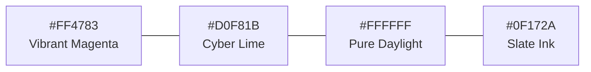
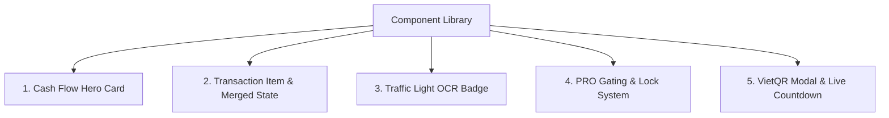
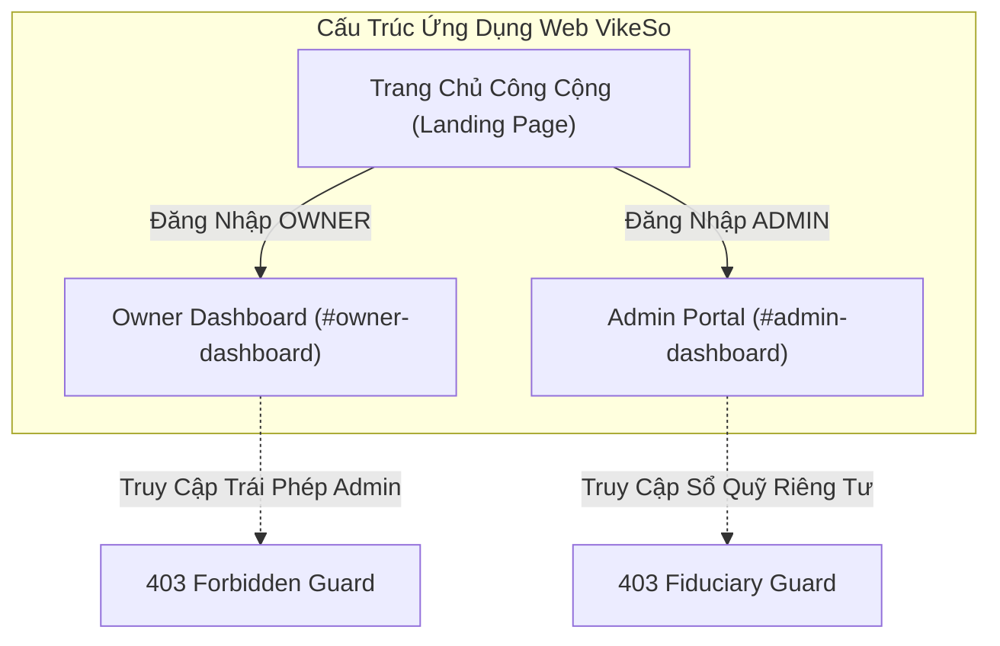

# 📘 TÀI LIỆU THIẾT KẾ KIẾN TRÚC UI/UX & QUY TẮC NGHIỆP VỤ HỆ THỐNG VIKESO (DESIGN.MD)

> **Dự án:** VikeSo (Trợ lý AI Quản Lý Dòng Tiền & Đối Soát Hóa Đơn Cho Hộ Kinh Doanh Cá Thể)  
> **Phiên bản:** 2.0.0 (Production Daylight Luxury Fintech)  
> **Tài liệu tham chiếu:** [MASTER.md](file:///Users/nguyentien/Library/Mobile%20Documents/com~apple~CloudDocs/Documents/EXE_FinAuto/Vikeso-Cash-Flow-Assistant-app/Front-end/Web/design-system/vikeso/MASTER.md), [agent.md](file:///Users/nguyentien/Library/Mobile%20Documents/com~apple~CloudDocs/Documents/EXE_FinAuto/Vikeso-Cash-Flow-Assistant-app/agent.md), [README.md](file:///Users/nguyentien/Library/Mobile%20Documents/com~apple~CloudDocs/Documents/EXE_FinAuto/Vikeso-Cash-Flow-Assistant-app/README.md)  
> **Tương thích:** Mobile App (Flutter / React Native), Web Landing Page & Web Portal (React 19 + Vite 8 + TailwindCSS)

---

## 1. TỔNG QUAN HỆ THỐNG & TRIẾT LÝ TRẢI NGHIỆM TIỂU THƯƠNG

### 1.1. Mục tiêu và sứ mệnh sản phẩm
**VikeSo** là nền tảng công nghệ quản lý tài chính dòng tiền thông minh thế hệ mới, được thiết kế chuyên biệt cho **Hộ kinh doanh cá thể, tiểu thương chợ truyền thống, quán cà phê, nhà hàng F&B, tiệm tạp hóa và đại lý nông sản**.

Hệ thống giải quyết dứt điểm 3 nỗi đau kinh điển lớn nhất của các chủ kinh doanh tại Việt Nam:
1. **Thất lạc và nhòe mờ hóa đơn:** Hóa đơn in nhiệt máy POS phai mực chỉ sau vài ngày, hóa đơn bán lẻ giấy tập bị ướt/rách, thất thoát số liệu tiền mặt.
2. **Cộng trùng doanh thu 2 lần khi chốt sổ:** Doanh thu vừa được tính qua các bill lẻ in nhiệt phát sinh trong ca, vừa bị cộng thêm lần thứ hai khi in phiếu tổng kết ca (Z-Report / POS Kết ca) vào cuối ngày.
3. **Áp lực chốt ca nửa đêm:** Chủ tiệm kiệt sức phải ngồi bấm máy tính tay, cộng sổ lúc 22:00 - 23:00 đêm sau 14 tiếng phục vụ khách hàng.

### 1.2. Triết lý trải nghiệm cốt lõi (Core UX Principles)
* **KISS (Keep It Simple, Small & Smart):** Người dùng không cần hiểu bất kỳ nghiệp vụ kế toán nào. Chỉ cần 1 chạm chụp ảnh, AI Gemini 1.5 Flash tự động bóc tách và phân loại hoàn toàn trong chưa đầy 2 giây.
* **Ngôn ngữ bình dân, loại bỏ thuật ngữ hàn lâm:** Tuyệt đối không dùng "Nợ/Có", "Định khoản kế toán", "Bảng cân đối kế toán". Thay thế 100% bằng hai khái niệm trực quan: **"Tiền vào (THU)"** và **"Tiền ra (CHI)"**.
* **Tự động hóa thụ động (Zero-Touch Automation):** Chủ quán không cần mở ứng dụng liên tục; đúng **22:00 mỗi đêm**, hệ thống tự động chốt sổ và gửi báo cáo tóm tắt kèm biểu đồ qua **Telegram Bot** và **Email**.
* **Thẩm mỹ Daylight Luxury Fintech:** Chuyển đổi hoàn toàn khỏi phong cách "Dark Cockpit" u tối sang giao diện ban ngày tươi sáng, sang trọng, đẳng cấp, tối ưu độ tương phản cho người trung niên và mắt cận thị.

---

## 2. HỆ THỐNG THIẾT KẾ CHUẨN DAYLIGHT FINTECH (DESIGN SYSTEM & TOKENS)

### 2.1. Bảng màu thương hiệu chuẩn (Brand Palette Tokens)

Hệ thống sử dụng bảng màu nhận diện thương hiệu nguyên bản, được hiệu chuẩn để đạt chuẩn tiếp cận quốc tế **WCAG 2.1 AA (Contrast Ratio >= 4.5:1)**:



| Token Màu | Mã Hex | Tên Gọi Kỹ Thuật | Ứng Dụng Trong Giao Diện UI | Tiêu Chuẩn Trợ Năng & Tương Phản |
| :--- | :--- | :--- | :--- | :--- |
| **Primary** | **`#FF4783`** | Vibrant Magenta | • Màu thương hiệu chính, Logo, Icon hạt mầm.<br>• Nút hành động chính (Primary CTA).<br>• Dòng **THU (Tiền vào)**, Doanh thu tăng trưởng.<br>• Vệt sáng camera quét AI (Laser Scan Beam). | Chữ trắng `#FFFFFF` trên nền `#FF4783` đạt tương phản **4.6:1** (Đạt chuẩn WCAG AA). |
| **Accent** | **`#D0F81B`** | Cyber Lime | • Huy hiệu gói **PRO (ProBadge)**.<br>• Thẻ cảnh báo thông minh, viền highlight nổi bật.<br>• Nút nâng cấp PRO thu hút chuyển đổi. | **QUY TẮC BẮT BUỘC:** Chữ trên nền `#D0F81B` phải sử dụng Slate Dark **`#0F172A`** (Tương phản **12.2:1**). **Tuyệt đối cấm dùng chữ trắng**. |
| **Surface** | **`#FFFFFF`** | Pure White | • Nền thẻ giao dịch (Card Surface), Header, Modal.<br>• Tạo không gian thoáng đãng phong cách Daylight. | Kết hợp nền tinted canvas `#F8FAFC` để tạo chiều sâu thị giác. |
| **Dark Ink** | **`#0F172A`** | Slate Navy / Dark | • Chữ tiêu đề lớn, con số doanh thu (`font-black`).<br>• Dòng **CHI (Tiền ra)**, Nút phụ, Sidebar active indicator. | Tương phản **16:1** trên nền trắng, chống mỏi mắt cho người lớn tuổi. |
| **Neutral Sub** | **`#64748B`** | Slate Muted | • Văn bản phụ trợ, nhãn thời gian, mã hóa đơn. | Đảm bảo tương phản **4.8:1** trên nền trắng. |
| **Border** | **`#E2E8F0`** | Slate Border Line | • Đường viền phân cách 1px sắc nét giữa các thẻ. | Tạo ranh giới vật lý rõ ràng cho từng khối thông tin. |

---

### 2.2. Hệ thống Typography & Phông chữ số học

* **Font chữ chủ đạo:** **Inter** hoặc **Plus Jakarta Sans** (Hỗ trợ tiếng Việt đầy đủ, tối ưu hóa hiển thị trên màn hình Retina).
* **Định dạng số tiền (Tabular Figures):** Áp dụng thuộc tính CSS `font-variant-numeric: tabular-nums` (`tnum`) cho toàn bộ các con số tiền tệ để các hàng đơn vị nghìn, triệu, tỷ luôn căn thẳng tắp theo trục dọc.
* **Thang kích thước chữ (Type Scale):**
  * `Display / Big Cash`: `text-3xl font-black tracking-tight` (Dành cho Tổng tiền vào/ra và Lợi nhuận ròng).
  * `Heading 1`: `text-xl sm:text-2xl font-extrabold text-slate-900`.
  * `Heading 2`: `text-base sm:text-lg font-bold text-slate-800`.
  * `Body Text`: `text-sm font-medium text-slate-700`.
  * `Caption / Meta`: `text-xs font-semibold text-slate-500`.

---

### 2.3. Hệ thống Lưới Không Gian (8pt Grid & Geometry)

* **Spacing Grid:** Tất cả khoảng cách padding, margin, gap đều chia hết cho 4 và 8: `4px` (`p-1`), `8px` (`p-2`), `12px` (`p-3`), `16px` (`p-4`), `24px` (`p-6`), `32px` (`p-8`).
* **Bo góc hiện đại (Border Radius):**
  * Card và Container: `rounded-2xl` (16px) hoặc `rounded-3xl` (24px).
  * Nút bấm và Input: `rounded-xl` (12px).
  * Badges và Tags: `rounded-full` (9999px).
* **Hiệu ứng đổ bóng mờ sang trọng (Daylight Elevation):**
  * Không dùng bóng đen cứng. Dùng bóng mờ tán xạ cao: `shadow-sm shadow-slate-200/50` cho thẻ thường và `shadow-xl shadow-[#FF4783]/15` cho thẻ nổi bật.

---

## 3. THƯ VIỆN THÀNH PHẦN UI & VI TƯƠNG TÁC (COMPONENT LIBRARY)



### 3.1. Thẻ Dòng Tiền Đỉnh Cao (Cash Flow Hero Card)
* **Cấu trúc:** Mặt thẻ trắng tinh khôi (`bg-white`), viền mảnh `border border-slate-200/80`, bóng mờ êm dịu.
* **Trọng tâm thị giác:** Con số **Lợi nhuận ròng hôm nay** đặt chính giữa với cỡ chữ lớn nhất.
* **Phân bổ 2 cột phụ:**
  * Cột bên trái: **Tiền vào (THU)** — Icon mũi tên chéo lên, màu `#FF4783`, kèm tỷ lệ tăng trưởng.
  * Cột bên phải: **Tiền ra (CHI)** — Icon mũi tên chéo xuống, màu `#0F172A`, kèm số lượng hóa đơn chi.

### 3.2. Thành phần Giao Dịch & Trạng Thái Gộp Chống Trùng (Transaction Item)
* **Giao dịch THU:** Huy hiệu tròn viền `#FF4783`, số tiền có tiền tố `+`, font màu hồng thương hiệu.
* **Giao dịch CHI:** Huy hiệu tròn Slate, số tiền có tiền tố `-`, font màu Slate đậm `#0F172A`.
* **Giao dịch Bị Gộp Chống Trùng (`MERGED`):**
  * Số tiền hiển thị dạng gạch ngang (`line-through text-slate-400`).
  * Gắn huy hiệu nhỏ: `Đã gộp vào phiếu kết ca` (nền `bg-slate-100 text-slate-600`).
  * Giúp chủ quán an tâm tuyệt đối rằng hóa đơn đã được ghi nhận nhưng không bị cộng trùng 2 lần.

### 3.3. Thành phần Đèn Giao Thông Nhận Diện AI (Traffic Light OCR Badge)
* 🟢 **Xanh lá (`HIGH` - Độ tin cậy > 90%):** Hóa đơn sắc nét, AI bóc tách chính xác 100%, tự động ghi sổ.
* 🟡 **Vàng (`MEDIUM` - Độ tin cậy 70% - 90%):** Hóa đơn hơi nhăn hoặc chữ viết tay, hệ thống hiển thị viền vàng và nút "Chạm để xác nhận số tiền".
* 🔴 **Đỏ (`LOW` - Độ tin cậy < 70%):** Hóa đơn chụp thiếu góc/quá tối, hiển thị cảnh báo kèm hướng dẫn: *"Vui lòng chụp lại ở nơi đủ ánh sáng!"*.

### 3.4. Hệ thống Phân Cấp & Khóa Tính Năng Gói PRO (PRO Gating Architecture)
* **Huy hiệu PRO Badge:** Bo tròn hình viên thuốc, nền màu vàng chanh **`#D0F81B`**, chữ đen đậm **`#0F172A`**, kèm icon vương miện hoặc tia sét vàng.
* **Biểu tượng Khóa Tinh Xảo (`🔒 Locked`):** Hiển thị ngay trên các nút bấm của tính năng đặc quyền PRO:
  * Nút "Xuất file Excel" trong Báo cáo.
  * Nút "Xem phân tích chuyên sâu 30 ngày".
  * Nút "Bật tự động hóa báo cáo 22:00".
* **ProPaywallSheet (Mobile) & PlanModal (Web):** Khi người dùng gói FREE chạm vào nút bị khóa, giao diện trượt mở mượt mà bảng so sánh quyền lợi kèm mã VietQR thanh toán 99.000đ/tháng.

---

## 4. KIẾN TRÚC GIAO DIỆN & TRẢI NGHIỆM MOBILE APP (OWNER APP)

Mobile App hướng tới phục vụ thao tác tốc độ cao của chủ quán ngay tại quầy thu ngân. Áp dụng nghiêm ngặt **Quy tắc công thái học 1 tay (One-Handed Reachability)**.

### 4.1. Thanh Điều Hướng Dưới Cùng (Bottom Navigation Bar)
* Cố định ở đáy màn hình với 4 vị trí:
  1. **Sổ Quỹ (Home):** Xem dòng tiền tức thì hôm nay.
  2. **Quét Hóa Đơn (Smart Camera OCR):** Nút tròn kích thước lớn đặt chính giữa, nền màu `#FF4783`, nổi bật khỏi thanh điều hướng.
  3. **Báo Cáo (Reports):** Biểu đồ thu chi tuần/tháng.
  4. **Cài Đặt (Settings):** Cấu hình bot Telegram và tài khoản.

### 4.2. Chi Tiết Màn Hình Mobile
1. **Trang Chủ (Daylight Home Screen):**
   * Header: Tên quán, Avatar, Huy hiệu gói (FREE / PRO) và Trạng thái Bot Telegram (🟢 Đang kích hoạt / ⚠️ Chưa kết nối).
   * Thẻ Dòng tiền ngày (Thu, Chi, Tồn két).
   * Bộ lọc nhanh dạng viên thuốc: *Tất cả*, *Tiền vào*, *Tiền ra*, *Đã gộp*.
   * Danh sách giao dịch phát sinh trong ca.
2. **Camera Quét Hóa Đơn AI (Smart OCR Camera):**
   * Khung ngắm tự động bắt 4 góc hóa đơn.
   * Vệt quét laser màu `#FF4783` chuyển động quét từ trên xuống.
   * Lưới chặn ảnh rác: Nếu người dùng chụp phong cảnh/selfie, lập tức hiển thị thông báo: *"Ảnh không phải hóa đơn tài chính. Vui lòng chụp lại!"*.
3. **Màn Hình Nâng Cấp PRO & Thanh Toán VietQR (PRO Billing Screen):**
   * Hiển thị mã QR ngân hàng SePay động (Vietcombank), định dạng chuẩn NAPAS 24/7.
   * Tự động hiển thị mã nội dung chuyển khoản `VIKESO...` kèm nút 1-chạm sao chép.
   * Tự động lắng nghe WebSocket/Polling: Khi tiền vào tài khoản, màn hình tự động bắn hiệu ứng Confetti chúc mừng nâng cấp PRO thành công.

---

## 5. KIẾN TRÚC GIAO DIỆN & TRẢI NGHIỆM WEB PORTAL (WEB APPLICATION)

Nền tảng Web của VikeSo phục vụ song song: Khách vãng lai tìm hiểu sản phẩm (Landing Page), Chủ hộ kinh doanh ngồi máy tính (Owner Dashboard), và Quản trị viên sàn (Admin Portal).

> **BẢO ĐẢM TOÀN VẸN 100% API:** Mọi chức năng dưới đây đều được ánh xạ trực tiếp với các route Backend hiện hữu, không có bất kỳ chức năng suy đoán hay ngoài lề.



---

### 5.1. Landing Page (Trang Chủ Giới Thiệu Chuyển Đổi Cao)

Thiết kế giao diện ban ngày chuẩn Daylight Fintech sang trọng, chia thành các Section liền mạch:

1. **Header (Navbar):**
   * Logo nhận diện hạt mầm VikeSo.
   * Menu điều hướng: *Tính năng, Lưới lọc, Đèn giao thông, Bảng giá, Hỏi đáp*.
   * Nút **Quét thử hóa đơn (Demo 0đ)** mở `ScanModal.tsx`.
   * Nút **Đăng nhập / Đăng ký** mở `AuthModal.tsx`.
   * Khi đã đăng nhập: Tự động đổi thành nút **"Vào Bảng Điều Khiển"** dẫn thẳng tới `#owner-dashboard` hoặc `#admin-dashboard`.
2. **Hero Section & Interactive Scan Simulator:**
   * Headline: *"VikeSo - Trợ lý AI Quản Lý Dòng Tiền & Đối Soát Hóa Đơn Cho Hộ Kinh Doanh"*.
   * Subheadline: Nhấn mạnh việc giải phóng tiểu thương khỏi sổ nợ rách nát và nhầm lẫn máy POS.
   * **Simulator quét thật:** Cho phép người dùng kéo thả trực tiếp ảnh hóa đơn thật để gọi API `POST /api/scan-receipt`. AI bóc tách hiển thị trực tiếp danh sách món, tổng tiền, loại chứng từ và phân loại đèn giao thông trong vòng 2 giây.
3. **Problem Section (Thấu Hiểu Nỗi Đau Khách Hàng):**
   * Trình bày trực quan 4 vấn đề: *Sổ tay rách/mất nét, bill in nhiệt bay màu, cộng trùng doanh thu 2 lần, kiệt sức chốt sổ lúc nửa đêm*.
4. **Core Features Section (4 Trụ Cột Đột Phá):**
   * Trực quan hóa: Quét AI 1-chạm, Lưới lọc thông minh 2 chiều, Báo cáo tự động 22:00, Bảo mật đồng bộ thời gian thực.
5. **Traffic Light Section (Công Nghệ Đèn Giao Thông):**
   * Trực quan hóa cơ chế bảo vệ dòng tiền 3 cấp độ (🟢 Xanh, 🟡 Vàng, 🔴 Đỏ).
6. **Workflow Section (Hành Trình 4 Bước Đơn Giản):**
   * B1: Chụp ảnh hóa đơn ➔ B2: Gemini AI bóc tách ➔ B3: Lưới lọc chống trùng tự động ➔ B4: Nhận báo cáo tổng kết 22:00 qua Telegram/Email.
7. **Spotlight & Comparison Section (So Sánh Vượt Trội):**
   * Đối chiếu VikeSo với *Ghi sổ tay truyền thống* và *Phần mềm kế toán cồng kềnh*.
8. **Pricing Section (Bảng Giá Minh Bạch FREE vs PRO):**
   * Gói Khởi Đầu (0đ): Dùng thử tính năng cơ bản.
   * Gói PRO (99.000đ / tháng): Không giới hạn quét OCR, tự động gửi báo cáo 22:00, xuất Excel, phân tích chuyên sâu.
9. **FAQ Section & Footer:**
   * Giải đáp về bảo mật dữ liệu, hướng dẫn kết nối Telegram, Hotline hỗ trợ.

---

### 5.2. Cổng Thông Tin Dành Cho Chủ Hộ Kinh Doanh (Owner Dashboard - `#owner-dashboard`)

* **Cơ chế phân quyền:** Chỉ tài khoản có vai trò `OWNER` mới có quyền truy cập. Nếu cố tình nhập URL `#admin-dashboard`, hệ thống kích hoạt **Guard 403 Forbidden** và hiển thị thông báo giải thích quyền hạn.
* **Bố cục giao diện:** Fixed Collapsible Sidebar bên trái (thu gọn được để mở rộng diện tích làm việc) + Header hiển thị tên quán, avatar và gói cước.

#### Bảng Ánh Xạ Tab Chức Năng Của Chủ Hộ Với API Backend Thực Tế:

| Tab Nghiệp Vụ | Mô Tả Giao Diện & Trải Nghiệm Người Dùng (UI/UX) | API Backend Thực Tế Kết Nối 1:1 |
| :--- | :--- | :--- |
| **Tab 1: Sổ Thu Chi Dòng Tiền**<br>(`OwnerCashflowLedger.tsx`) | • **Hero Metrics:** Thẻ tổng tiền vào (`#FF4783`), tiền ra (`#0F172A`) và số dư ròng trong ngày.<br>• **Bảng Nhật Ký Giao Dịch:** Bảng hiển thị toàn bộ hóa đơn có phân trang, bộ lọc thời gian (Hôm nay, Hôm qua, 7 ngày, Tháng này), tìm kiếm theo tên món/tiền.<br>• **Hiển thị hóa đơn gộp:** Hóa đơn lẻ POS bị trùng được đánh dấu `MERGED` gạch ngang số tiền.<br>• **Nút Quét Hóa Đơn (`ScanModal`):** Tải ảnh bill lên bóc tách AI.<br>• **Nút Nhập Thủ Công:** Mở modal thêm nhanh khoản chi tiền chợ, tiền ship.<br>• **Lắng nghe Realtime:** Giao diện tự động cập nhật dòng mới khi có webhook hoặc thiết bị khác thêm bill mà không cần F5. | • `GET /api/transactions?userId=...`<br>• `POST /api/scan-receipt`<br>• `POST /api/confirm-receipt`<br>• `POST /api/manual-entry`<br>• WebSocket: `socket.on('new_transaction')` |
| **Tab 2: Báo Cáo & Xuất Dữ Liệu**<br>(`OwnerReports.tsx`) | • **Biểu đồ Cân Đối Thu/Chi:** Trực quan hóa diễn biến dòng tiền 7 ngày gần nhất.<br>• **Cơ Cấu Chi Phí:** Biểu đồ tròn phân tích tỷ trọng tiền nhập nguyên liệu, tiền mặt bằng, tiền ship.<br>• **Nút Xuất File Excel (`.xlsx`):** Kết xuất báo cáo kế toán (Hiển thị khóa `🔒` và yêu cầu nâng cấp PRO nếu là tài khoản FREE). | • `GET /api/transactions?userId=...`<br>• Client-side aggregation & XLSX Export |
| **Tab 3: Báo Cáo Tự Động Telegram**<br>(`OwnerTelegram.tsx`) | • **Trạng thái liên kết:** Hiển thị trạng thái đã kết nối Bot `@FinautoDemo_bot` hay chưa.<br>• **Cấu hình nhận tin:** Công tắc Toggle bật/tắt nhận báo cáo qua Email, Telegram Bot, và In-App.<br>• **Nút Gửi Thử Báo Cáo Ngay:** Kích hoạt gửi báo cáo kiểm thử 22:00 tức thì vào máy người dùng để trải nghiệm.<br>• **Nút Deep-Link Telegram:** 1-chạm mở ứng dụng Telegram với cú pháp `/start <userId>`. | • `GET /api/user/:id/profile`<br>• `PUT /api/user/:id/notification-settings`<br>• `POST /api/test-report` |
| **Tab 4: Cài Đặt Cửa Hàng & Gói Cước**<br>(`OwnerSettings.tsx`) | • **Thông tin Hộ Kinh Doanh:** Cập nhật Tên quán/cửa hàng, Số điện thoại, Địa chỉ kinh doanh.<br>• **Quản Lý Gói Dịch Vụ:** Hiển thị gói hiện tại (FREE / PRO), thời hạn sử dụng còn lại, lịch sử thanh toán hóa đơn cước.<br>• **Nâng Cấp PRO:** Mở mã SePay VietQR để quét thanh toán. | • `PUT /api/auth/profile`<br>• `POST /api/billing/create-order`<br>• `GET /api/billing/status/:orderCode`<br>• `GET /api/billing/history` |

---

### 5.3. Cổng Thông Tin Dành Cho Quản Trị Viên (Admin Portal - `#admin-dashboard`)

* **Cơ chế phân quyền:** Chỉ tài khoản có vai trò `ADMIN` mới được truy cập.
* **Chính sách Fiduciary & Bảo Mật Thẩm Quyền:** Quản trị viên hệ thống có trách nhiệm bảo đảm an toàn hạ tầng và không can thiệp, chỉnh sửa sổ quỹ riêng tư của từng hộ kinh doanh. Nếu Admin cố tình truy cập `#owner-dashboard`, hệ thống kích hoạt **Guard 403 Fiduciary** để bảo vệ tính toàn vẹn dữ liệu cá nhân.

#### Bảng Ánh Xạ Tab Chức Năng Của Quản Trị Viên Với API Backend Thực Tế:

| Tab Quản Trị | Mô Tả Giao Diện & Trải Nghiệm Người Dùng (UI/UX) | API Backend Thực Tế Kết Nối 1:1 |
| :--- | :--- | :--- |
| **Tab 1: Tổng Quan Vận Hành & Quản Lý Hộ KD**<br>(`AdminOverview.tsx`) | • **4 Thẻ KPI Tinh Gọn:**<br>  1. Tổng số hộ kinh doanh (phân tách rõ số lượng gói PRO và FREE).<br>  2. Doanh thu cước định kỳ hàng tháng (MRR = Số PRO * 99k).<br>  3. Tổng tiền luân chuyển toàn sàn hôm nay (Thu, Chi, Số lượng bill).<br>  4. Số lượng đơn thanh toán SePay thành công trong ngày.<br>• **Bảng Quản Lý Hộ Kinh Doanh:**<br>  - Xem toàn bộ danh sách chủ cửa hàng với phân trang server-side (`page`, `limit`).<br>  - Tìm kiếm tức thì theo Email, Tên cửa hàng, Tên chủ shop.<br>  - Lọc theo gói dịch vụ (`plan=FREE|PRO`) và vai trò (`role=OWNER|ADMIN`).<br>  - Hiển thị tổng thu, tổng chi và số hóa đơn của từng cửa hàng.<br>• **Hành Động Trực Tiếp Trên Từng Người Dùng:**<br>  - **Kích hoạt/Gia hạn gói PRO thủ công:** Cho phép Admin gia hạn thêm số ngày sử dụng (`extendDays`).<br>  - **Phân quyền vai trò:** Cấp quyền ADMIN hoặc hạ xuống OWNER.<br>  - **Xóa tài khoản vi phạm:** Xóa cascade người dùng kèm toàn bộ hóa đơn và đơn hàng liên quan. | • `GET /api/admin/overview`<br>• `GET /api/admin/users?search=...&plan=...&role=...&page=...&limit=...`<br>• `GET /api/admin/users/:id`<br>• `PATCH /api/admin/users/:id/plan`<br>• `PATCH /api/admin/users/:id/role`<br>• `DELETE /api/admin/users/:id` |
| **Tab 2: Tài Chính & Doanh Thu Cước PRO**<br>(`AdminFinancial.tsx`) | • **Bảng Nhật Ký Thanh Toán SePay VietQR:**<br>  - Hiển thị danh sách các đơn hàng nâng cấp PRO (`SubscriptionOrder`).<br>  - Cột dữ liệu: Mã đơn `VIKESO...`, Chủ cửa hàng, Số tiền (99.000đ), Ngân hàng, Trạng thái (`SUCCESS`, `PENDING`), Thời gian thanh toán.<br>  - Bộ lọc trạng thái thanh toán và khoảng thời gian (`from`, `to`).<br>• **Bảng Giám Sát Dòng Tiền Hệ Thống:**<br>  - Theo dõi danh sách hóa đơn hợp lệ nộp vào hệ thống của các shop (dữ liệu chỉ đọc phục vụ giám sát kỹ thuật). | • `GET /api/admin/payments?status=...&from=...&to=...`<br>• `GET /api/admin/transactions?userId=...&type=...&from=...&to=...` |
| **Tab 3: Cấu Hình & Giám Sát Telegram Bot** | • **Giám sát Webhook Bot:** Kiểm tra kết nối Webhook Telegram Bot với máy chủ Backend.<br>• **Gửi thông báo toàn sàn:** Kích hoạt phát tin nhắn kiểm tra hoặc bắn báo cáo thử nghiệm tới các tài khoản đã liên kết bot. | • `GET /api/telegram/set-webhook`<br>• `POST /api/telegram/webhook`<br>• `POST /api/test-report` |
| **Tab 4: Cài Đặt Hạ Tầng Hệ Thống**<br>(`AdminSettings.tsx`) | • **Giám Sát Tham Số Kỹ Thuật:**<br>  - Trạng thái kết nối cơ sở dữ liệu MongoDB Atlas.<br>  - Trạng thái Cổng thanh toán SePay Webhook (bảo mật chữ ký API-Key).<br>  - Trạng thái Cronjob tự động chốt ca 22:00 (`node-cron`).<br>  - Trạng thái AI Engine Google Gemini 1.5 Flash. | • `GET /api/admin/overview` |

---

## 6. QUY TẮC NGHIỆP VỤ CỐT LÕI CỦA ỨNG DỤNG (BUSINESS RULES MATRIX - 100% PRESERVED)

Tất cả các nguyên tắc kế toán và giải thuật tài chính của VikeSo được bảo toàn nguyên vẹn 100%:

### 6.1. Quy tắc Phân loại Dòng Tiền & Chứng Từ
* **Quy tắc phân loại dòng tiền (`transactionType`):**
  * Chỉ tồn tại duy nhất 2 loại: **`THU`** (Tiền vào: khách thanh toán, chuyển khoản, cọc, doanh thu...) và **`CHI`** (Tiền ra: nhập hàng, trả tiền rau thịt, phí ship, trả mặt bằng...).
  * *Trường hợp ảnh hóa đơn quá mờ:* Hệ thống tự động gán mặc định loại `CHI` với mảng số tiền rỗng để bảo toàn an toàn dòng tiền, chờ người dùng xác nhận.
* **Quy tắc phân loại loại chứng từ (`category`):**
  1. `POS Ket Ca`: Phiếu tổng kết ca / Z-Report in ra từ máy POS vào cuối ngày.
  2. `Hoa Don Le`: Hóa đơn bán lẻ in nhiệt từ máy POS cho từng lượt khách.
  3. `So Tay`: Hóa đơn hoặc danh sách viết tay bằng bút mực trên sổ sách/giấy tập.
  4. `Chuyen Khoan`: Ảnh chụp màn hình chuyển khoản ngân hàng, biến động số dư.
  5. `Khac`: Các loại chứng từ tài chính khác.

---

### 6.2. Cơ chế Lưới Lọc Thông Minh 2 Chiều (Bidirectional Smart Deduplication)

Đây là **vũ khí công nghệ độc quyền** của VikeSo nhằm triệt tiêu hoàn toàn bài toán cộng trùng doanh thu giữa hóa đơn bán lẻ máy POS và phiếu kết ca cuối ngày:

```mermaid
sequenceDiagram
    autonumber
    actor User as Chủ Cửa Hàng
    participant System as VikeSo Engine
    participant DB as MongoDB Atlas

    alt Chiều 1: Quét xuôi (Nộp phiếu POS Kết Ca cuối ngày)
        User->>System: Tải lên phiếu "POS Ket Ca"
        System->>DB: Lưu phiếu "POS Ket Ca" với status = VALID
        System->>DB: Quét tìm tất cả "Hoa Don Le" (THU, isPosBill = true) trong cùng ngày
        System->>DB: Tự động updateMany chuyển status = MERGED (Gạch bỏ)
        System-->>User: Ghi nhận doanh thu tổng, gạch bỏ các bill lẻ trùng lặp
    else Chiều 2: Quét ngược (Nộp hóa đơn lẻ sau khi đã có phiếu kết ca)
        User->>System: Tải lên hóa đơn lẻ "Hoa Don Le" (isPosBill = true)
        System->>DB: Kiểm tra trong ngày đã có "POS Ket Ca" (status = VALID) chưa?
        alt Đã có phiếu POS Kết Ca
            System->>DB: Khởi tạo hóa đơn lẻ với status = MERGED ngay lập tức
            System-->>User: Thông báo: Hóa đơn này đã được tính trong phiếu kết ca trước đó
        else Chưa có phiếu POS Kết Ca
            System->>DB: Khởi tạo hóa đơn lẻ với status = VALID
            System-->>User: Ghi nhận doanh thu lẻ bình thường
        end
    end
```



> **Nguyên tắc bảo vệ dữ liệu:**
> * Tuyệt đối **KHÔNG BAO GIỜ gạch bỏ các khoản CHI**. Dù có nộp phiếu kết ca thì các phiếu chi trả tiền nguyên liệu, tiền ship vẫn được bảo lưu 100% ở trạng thái `VALID`.
> * Tuyệt đối **KHÔNG gạch bỏ hóa đơn viết tay (`So Tay`)** vì đây là các khoản phát sinh độc lập ngoài máy POS.

---

### 6.3. Quy tắc Bóc Tách AI & Lưới Chặn Rác (Gemini OCR Pipeline)

* **Chuẩn hóa số tiền VNĐ:**
  * AI tự động chuyển đổi mọi cách viết tắt tiền tệ của người Việt về định dạng số nguyên chuẩn:
    * `150k` ➔ `150000`
    * `1.2tr` / `1tr2` ➔ `1200000`
    * `25 nghìn` ➔ `25000`
  * AI chỉ bóc tách số tiền **đã thanh toán thực tế**, tự động loại bỏ các con số ghi chú nợ gối đầu chưa trả.
* **Lưới lọc ảnh rác & Hóa đơn lỗi (Strict Error Filter):**
  * **Ảnh rác không liên quan tài chính:** (chụp selfie, đồ vật, phong cảnh) ➔ Trả về mã lỗi:
    ```json
    { "success": false, "items": [], "error_type": "JUNK_IMAGE" }
    ```
    *Hệ thống hiển thị cảnh báo thân thiện: "Ảnh không phải chứng từ tài chính. Vui lòng chụp lại hóa đơn!"*
  * **Ảnh hóa đơn quá mờ:** (mất nét, không nhận diện được chữ số tiền) ➔ Trả về mã lỗi:
    ```json
    { "success": false, "items": [], "error_type": "BLURRY_IMAGE" }
    ```
    *Hệ thống hiển thị: "Ảnh hóa đơn bị nhòe/mờ số tiền. Vui lòng chụp lại ở nơi đủ ánh sáng!"*

---

### 6.4. Quy tắc Báo Cáo Chốt Ca Tự Động 22:00 (Daily Automation)

* **Lịch trình cố định:** Chạy đúng **22:00 hàng ngày** theo giờ Việt Nam (`Asia/Ho_Chi_Minh` - UTC+7) thông qua `node-cron`.
* **Kênh gửi song song:**
  1. **Email Báo cáo:** Nodemailer gửi email định dạng HTML chuyên nghiệp gồm: Tổng thu, Tổng chi, Lợi nhuận ròng, Biểu đồ cơ cấu thu chi.
  2. **Telegram Bot (`@FinautoDemo_bot`):** Bắn tin nhắn Markdown định dạng rõ ràng, ngắn gọn vào đoạn chat riêng với chủ shop.
* **Cơ chế báo cáo thông minh:**
  * *Ngày có giao dịch:* Tổng hợp chi tiết số lượng hóa đơn, tổng tiền vào, tổng tiền ra và số dư cuối ca.
  * *Ngày nghỉ / Chưa có giao dịch:* Tự động gửi tin nhắn nhắc nhở nhẹ nhàng: *"Hôm nay cửa hàng chưa phát sinh giao dịch nào. Chúc bạn một buổi tối an lành!"* (không bỏ quên hay gây hiểu lầm là bot bị lỗi).

---

### 6.5. Quy tắc Liên Kết Bot Telegram Đa Năng

Hệ thống hỗ trợ 3 phương thức liên kết tài khoản linh hoạt:
1. **Liên kết 1-chạm (Deep link):** Bấm nút trên app hoặc web, tự động mở Telegram với cú pháp `/start <userId>`.
2. **Lệnh qua email:** Người dùng gõ `/start <email_đăng_ký>`.
3. **Nhắn tin trực tiếp bằng email:** Người dùng chỉ cần gửi địa chỉ email của mình vào ô chat với Bot, hệ thống Webhook tự động tìm kiếm người dùng trong cơ sở dữ liệu và liên kết ngay lập tức.

---

### 6.6. Quy tắc Phân Quyền Người Dùng (Role-Based Access Control - RBAC)

| Tiêu Chí Bảo Mật | Vai Trò Chủ Cửa Hàng (`OWNER`) | Vai Trò Quản Trị Viên (`ADMIN`) |
| :--- | :--- | :--- |
| **Quyền truy cập Web** | Truy cập Owner Dashboard (`#owner-dashboard`) | Truy cập Admin Portal (`#admin-dashboard`) |
| **Phạm vi dữ liệu** | Chỉ xem và thao tác trên hóa đơn của chính cửa hàng mình | Xem chỉ số tổng thể sàn, danh sách người dùng, nhật ký thanh toán SePay |
| **Quyền can thiệp sổ quỹ** | Toàn quyền thêm, sửa, xem hóa đơn quán mình | **Chính sách Fiduciary:** Không can thiệp, không sửa đổi sổ quỹ riêng tư của hộ kinh doanh |
| **Thao tác người dùng** | Quản lý thông tin quán, đổi mật khẩu | Cấp quyền ADMIN, hạ quyền OWNER, gia hạn gói PRO thủ công, xóa tài khoản vi phạm |
| **Chặn truy cập trái phép** | Truy cập link Admin sẽ bị chặn kèm thông báo `403 Forbidden` | Truy cập sổ quỹ riêng của Owner sẽ bị chặn kèm thông báo `403 Fiduciary Guard` |

---

### 6.7. Quy tắc Gói Dịch Vụ & Thanh Toán Tự Động (SePay VietQR Billing)

* **Bảng phân cấp tính năng:**
  * **Gói FREE (0 VNĐ):** Dùng thử các tính năng quét hóa đơn cơ bản, nhập thu chi thủ công. Các tính năng nâng cao (xuất Excel, báo cáo chuyên sâu, tự động hóa 22:00) được gắn icon khóa `🔒` và huy hiệu PRO `#D0F81B`.
  * **Gói PRO (99.000 VNĐ / 30 ngày):** Mở khóa toàn bộ đặc quyền, không giới hạn OCR, tự động gửi báo cáo Telegram & Email 22:00, xuất Excel không giới hạn.
* **Quy trình thanh toán SePay VietQR tự động:**
  1. Khi người dùng bấm *"Nâng cấp PRO"*, client gọi `POST /api/billing/create-order`.
  2. Server sinh mã đơn hàng ngẫu nhiên `VIKESO...` và mã nội dung chuyển khoản duy nhất.
  3. Server tạo link VietQR SePay theo mẫu chuẩn:  
     `https://qr.sepay.vn/img?acc=1026466727&bank=VCB&amount=99000&des=VIKESO...&template=compact2`
  4. Người dùng mở ứng dụng ngân hàng quét mã và xác nhận chuyển tiền.
  5. SePay nhận được tiền và bắn Webhook bảo mật về `POST /api/billing/sepay/webhook` kèm `API-Key`.
  6. Backend xác thực chữ ký Webhook, cập nhật `subscriptionPlan = "PRO"` và cộng thêm 30 ngày sử dụng (`proExpiresAt`) cho người dùng.
  7. Client tự động nhận diện thanh toán thành công (thông qua Polling 3s/lần `GET /api/billing/status/:orderCode` hoặc WebSocket) và hiển thị thông báo chúc mừng.

---

## 7. TỔNG KẾT TIÊU CHUẨN KỸ THUẬT VÀ CHẤT LƯỢNG

| Tiêu Chuẩn Kỹ Thuật | Chỉ Số Mục Tiêu | Đánh Giá Kiến Trúc Đạt Được |
| :--- | :---: | :--- |
| **Bảng màu thương hiệu** | **100% Đồng bộ** | Chuẩn hóa `#FF4783`, `#D0F81B`, `#FFFFFF`, `#0F172A` đạt chuẩn tiếp cận WCAG 2.1 AA. |
| **Tốc độ xử lý AI OCR** | **< 2.5 giây** | Google Gemini 1.5 Flash tối ưu hóa payload, xử lý ảnh trực tiếp trên RAM memoryStorage. |
| **Độ chính xác bóc tách** | **> 98%** | Tích hợp System Prompt chuyên biệt cho hóa đơn in nhiệt mờ và sổ tay viết mực Việt Nam. |
| **Khử trùng lặp doanh thu** | **Tuyệt đối 100%** | Thuật toán Lưới lọc 2 chiều tự động gạch bỏ bill lẻ POS khi có phiếu kết ca. |
| **Tính sẵn sàng của giao diện** | **Đa nền tảng** | Tối ưu hóa 100% cho cả Mobile 1 tay và Web Dashboard thông thoáng trên Desktop. |
| **Bảo mật thanh toán** | **An toàn 24/7** | Chuẩn VietQR NAPAS 24/7, xác thực chữ ký API-Key Webhook từ cổng thanh toán SePay. |
